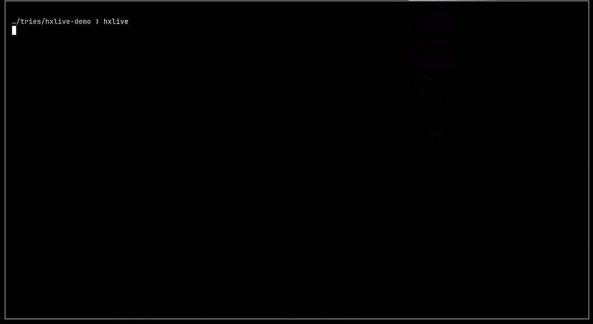

# hxlive

Helix in the terminal, live preview in a browser window beside it. Saving with
`:w` reloads the preview (CSS is injected without a reload), `:q` shuts down
the server and closes the window. Works on macOS and Linux (Omarchy/Hyprland
or any other desktop).



```sh
mkdir playground && cd playground
hxlive init      # create index.html + style.css
hxlive           # start hacking
```

## Installation

```sh
curl -fsSL https://raw.githubusercontent.com/gobijan/hxlive/main/install.sh | bash
```

or from a clone, so `git pull` keeps it up to date:

```sh
git clone https://github.com/gobijan/hxlive.git ~/Work/hxlive
~/Work/hxlive/install.sh        # symlinks into ~/.local/bin
```

The installer runs `hxlive doctor`, which checks dependencies and tells you
what's missing (run it again any time):

| | macOS | Omarchy / Arch |
|---|---|---|
| Helix | `brew install helix` | `pacman -S helix` |
| Browser | Chrome, Chromium, Brave or Edge | Chromium (Omarchy default) |
| Server | `mise use -g npm:browser-sync` or just Node (then via `npx`) | same |
| recommended | `mise use -g superhtml` | same |
| recommended | [html-class-lsp](https://github.com/gobijan/html-class-lsp): `go install github.com/gobijan/html-class-lsp@latest` | same |

### CSS class completion

[html-class-lsp](https://github.com/gobijan/html-class-lsp) completes CSS
class names inside `class="…"` from the stylesheets the page actually loads,
jumps to their definition with `gd` and warns about undefined classes. Since
hxlive is all about editing HTML and CSS side by side, `hxlive doctor` checks
that it's installed *and* enabled in Helix (via `hx --health html`). If it
isn't enabled, it prints the `languages.toml` snippet to add, keeping the
HTML language servers you already use.

## Commands

```
hxlive [files…]     server + preview + Helix (no arguments: index.html,
                    style.css, script.js, if present)
hxlive init         create starter files
hxlive serve        server only, logs in the terminal
hxlive preview      (re)open the preview window
hxlive close        close all hxlive preview windows
hxlive check        validate HTML with superhtml
hxlive doctor       check dependencies and editor setup
-p, --port N        port (default 3000; if taken, hxlive uses the next free one)
```

Environment variables: `HXLIVE_PORT`, `HXLIVE_EDITOR` (e.g. `nvim`),
`HXLIVE_BROWSER` (path to a Chromium-based browser).

## Window placement

- **Hyprland:** launched via `hyprctl` with `no_initial_focus`. The window is
  tiled next to the terminal and focus stays on Helix.
- **macOS:** opens on the right half of the screen, then focus returns to the
  terminal. If you move the window, the profile remembers the new position.
- **Other desktops:** a normal window, placed by the window manager.

The preview is an `--app` window (no tabs, no address bar) with its own
profile under `~/.cache/hxlive/`, so hxlive can close it precisely without
touching your regular browser.
